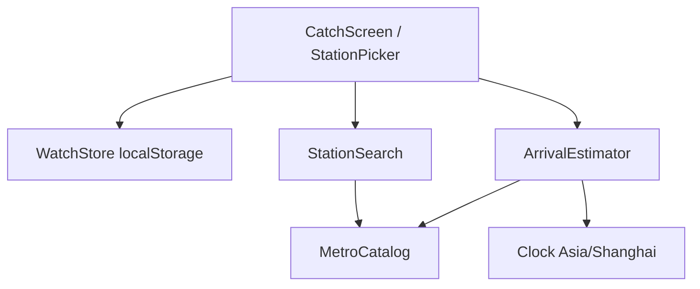

# 深圳地铁赶车助手

Feature Name: shenzhen-metro-catch
Updated: 2026-11-25

## Description

手机优先的 Web 应用。用户先选地铁或公交，再选定站点、线路与方向后，赶车页展示目标班次剩余分钟数或已错过状态，并列出随后几班估算到站时间。到站时间由首末班与分时段发车间隔在客户端推算，界面标明「估算」。地铁覆盖全部在运营线路与站点；公交覆盖全市线路（深圳市公共交通管理局 2026 年 10 月一览表途经站点），无官方实时到站。

## Architecture



单页静态前端。站点与时刻参数打包进前端数据文件，无独立后端。打开页面后读取上次盯车目标，立即进入赶车页。

## Components and Interfaces

### CatchScreen

赶车主界面。展示站点名、线路色条、方向、目标班次倒计时或错过、随后班次列表、最近刷新时间、估算说明。

### StationPicker

站点搜索与浏览。支持站名、拼音、拼音首字母。选站后列出该站全部线路与两个方向，确认后写回 WatchStore 并返回赶车页。

### MetroCatalog

静态线网目录。线路、有序站点、线路色、贯通交路（2/8 号线）、分时段发车间隔、首末班基准时刻。

### ArrivalEstimator

输入：线路、站点在线路中的序号、方向、当前时刻。
输出：当日该方向剩余 Arrival 列表，每条含预计到站时刻与剩余整分钟。

推算规则：
1. 以线路终点站首班时刻为锚点，按站间运行 2.5 分钟推到目标站的首班到站时刻。
2. 按当前时段 headway 从首班起生成虚拟班次，直到末班。
3. 高峰 07:00-09:00 与 17:30-19:30 使用高峰间隔，其余运营时段使用平峰间隔，21:30 后使用晚间间隔。
4. 返回当前时刻之后的班次；当前时刻晚于末班则返回空列表。

### WatchStore

将 `{ stationId, lineId, directionId, targetArrivalIso }` 写入 `localStorage` 键 `szmetro-watch-v1`。

## Data Models

```text
Line { id, name, color, stationIds[], firstTrain, lastTrain, headwayPeakMin, headwayOffpeakMin, headwayLateMin, throughWith? }
Station { id, name, pinyin, abbr, lineIds[] }
WatchTarget { stationId, lineId, directionId, targetArrivalIso? }
Arrival { eta, minutesLeft, status: upcoming | arriving | missed }
```

方向 id 为线路两个终点站 id。2 号线与 8 号线按贯通交路生成赤湾至溪涌的到站序列。

## Correctness Properties

- 同一 WatchTarget 在同一时刻得到的 Arrival 序列稳定。
- minutesLeft 为向下取整的非负整数；0 且 eta 未过显示「即将到站」。
- eta 早于当前时刻的目标班次标记为 Missed，并高亮下一班。
- 搜索结果只包含目录中的在运营站点。
- 时区固定为 Asia/Shanghai。

## Error Handling

- 目录加载失败：展示重试，保留内存中已有目录。
- 无剩余班次：展示「本方向今日已停运」。
- 当前时刻早于首班：展示首班预计到站时刻。
- 估算说明常驻赶车页，避免被理解成官方实时信号。

## Test Strategy

- ArrivalEstimator：固定时钟验证高峰/平峰/末班/首班前/错过。
- StationSearch：中文、拼音、首字母、换乘站多线路。
- WatchStore：读写与缺省恢复。

## References

[^1]: (Website) - [深圳市交通运输局地铁线路信息](https://jtys.sz.gov.cn/ydmh/jtcx/dtcx_180970/dtxl/content/post_12601090.html)
